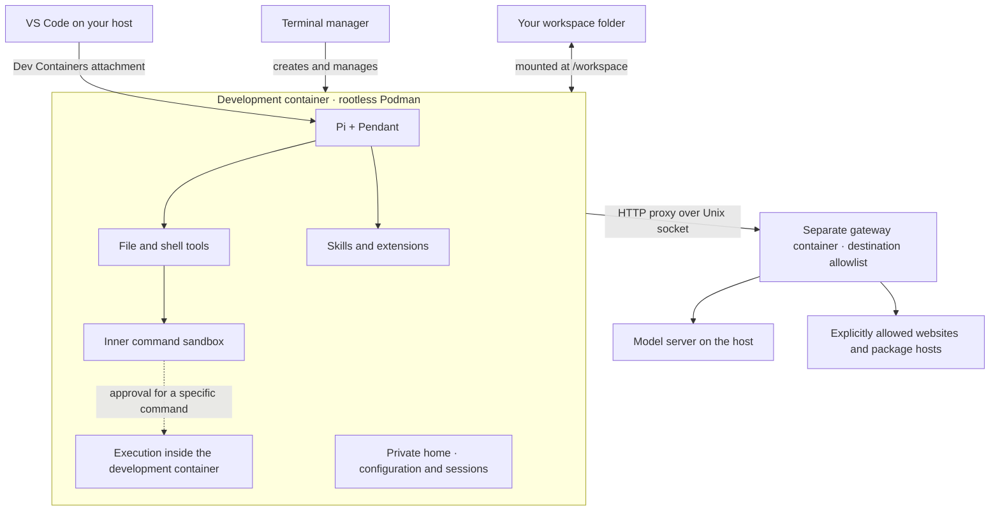

# Local AI Sandboxes

Run Pi and Pendant in a container, with a dedicated VS Code window and a terminal interface for managing your sandboxes. Each sandbox keeps its own agent configuration, sessions and editor state while working on a folder you choose.


## Get started

You need Linux, Python 3.9+, Git, rootless Podman and desktop VS Code with `code` on your PATH. Docker is also supported, but connecting to a model on host loopback requires rootless Podman. The first build downloads Pi, Pendant, extensions and document tools.

```sh
git clone https://github.com/kyuz0/local-ai-sandboxes.git
cd local-ai-sandboxes
python3 -m venv .venv
.venv/bin/pip install -r requirements-tui.txt
.venv/bin/python sandbox.py
```

Choose **New sandbox**, select a workspace folder and create it. Start your model server separately, for example with AI Toolbox Cockpit on port `8000`. Enable that host port in the sandbox configuration, then **Open in VS Code**. Model discovery runs before the editor opens; if the server starts later, use **Settings → Models → Refresh catalogue**.

## How it fits together



In restricted mode, the development container has no direct network access. Its proxy settings send requests through the gateway. The model runs outside the sandbox; `local-model.internal` reaches the host ports you explicitly allow.

Pi's inner command sandbox restricts shell commands further. Requests beyond it use the configured approval mode: automatic review or a human decision. An approved command still runs inside the development container; elevation does not grant host access or bypass the gateway. Skills add instructions and tools, not network permissions.

## Everyday use

- **Settings → Network:** edit allowed destinations or enable the pip and GitHub presets. Applying rules briefly restarts only the gateway.
- **Settings → Models:** preview discovery or refresh the saved catalogue.
- **Settings → Advisors:** enable Codex or Antigravity in a separate container and sign in. [Setup and diagram](docs/advisors.md).
- **Settings → SSH:** choose hosts and import a key into a separate companion. [SSH and GitHub setup](docs/ssh.md).
- **Actions:** start or stop a sandbox, open Pi or a shell, view logs, rebuild or delete it.

The base environment includes document tools, Pendant's built-in goals and scheduled prompts. Browser support, subagents and additional skills are optional. Closing the manager or editor leaves containers running. Deleting a sandbox removes its private state but preserves your workspace folder.

[Extensions](docs/extensions.md) · [Usage and CLI](docs/usage.md) · [Architecture and permissions](docs/architecture.md) · [Tests](TESTING.md)
