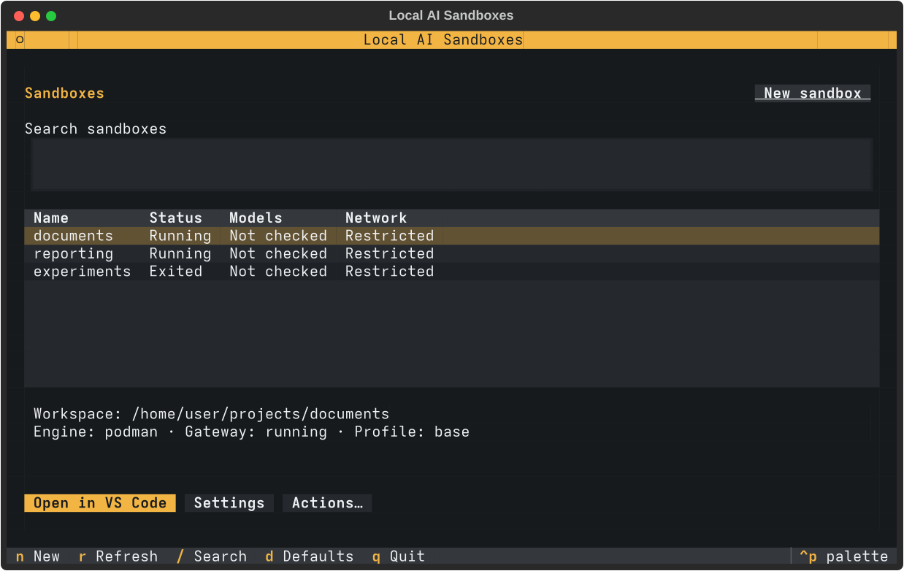

# Pi Sandbox Factory

Pi Sandbox Factory makes it easy to run Pi coding agents in a sandbox, with
controls over the files they can access, the commands they can run and the
network destinations they can reach. The agent works inside a development
container with access to your chosen project folder. Network access is restricted
by default, and commands that need broader permissions go through approval.
Approved commands still run inside the container.

You manage sandboxes through a terminal interface. Open them in VS Code with
Pendant, its Pi chat extension, or use Pi directly in your terminal. You can also
use both at once. Each sandbox keeps its own tools, model settings and
conversations. Local model discovery is included;
you can add other providers and reusable profiles for different projects.



## Install

You need Linux, Python 3.10+, Git and rootless Podman. For the VS Code interface,
install desktop VS Code with `code` on your PATH. The launcher installs the Dev
Containers extension if needed.
Docker also works, but forwarding a host-loopback model requires rootless Podman.

Install pipx with your distribution's package manager, then:

```sh
pipx ensurepath
pipx install git+https://github.com/kyuz0/pi-sandbox-factory.git
pi-sandbox-factory
```

Open a new terminal after `pipx ensurepath` if the command is not found.
The first sandbox build downloads Pi, Pendant and their dependencies.

The manager checks GitHub for updates in the background. **Upgrade now** runs
`pipx upgrade pi-sandbox-factory` after confirmation and restarts the manager.
You can run the same command in your terminal. Existing sandboxes receive image
updates through **Actions → Update sources and recreate…**.

Choose **New sandbox**, select your project folder and enable the port used by
your model server, usually `8000`. Create it, then choose **Open in VS Code** or **Open Pi CLI**.
Start the model server separately. If it starts later, use **Settings → Models →
Refresh**. [CLI and everyday use](docs/usage.md).

## Add your own environment

A **Profile** sets up the working environment for a task: its tools, skills,
extensions and agent instructions. A **Provider** connects Pi to a model service
and configures the available models. You choose them separately, so the same
profile can work with local models or a hosted service. Both can be installed
from Git repositories or local folders.

Open **Packages** to view installed profiles and providers. Choose **Install profile…**
or **Install provider…** to add one; **Update** and **Remove** appear beside each
installed item. You can also install from a Git URL:

```sh
pi-sandbox-factory profile add reporting git@git.example.com:team/reporting.git
pi-sandbox-factory provider add company git@git.example.com:team/company-models.git
```

For repositories containing several plugins, add `--subdir FOLDER` to select one.
The same folder is used by subsequent updates.

Select the profile during creation. Choose providers in **Configuration** and
enter credentials through **Settings → Models**. Git authentication uses your
host account; it is not copied into the sandbox.

A profile or provider contains executable code. Install packages you trust.
Configure allowed hosts and website categories under **Network**.
Existing sandboxes retain their saved package versions until you update them.

- [Create a profile](docs/profiles.md), with a runnable reporting example.
- [Create a provider](docs/providers.md), including the adapter contract.
- [Web search and website categories](docs/web-access.md).
- [Isolation and architecture](docs/architecture.md), [approvals](docs/approvals.md), [SSH](docs/ssh.md), [advisors](docs/advisors.md).
- [Development and tests](TESTING.md), [agent guide](AGENTS.md).
