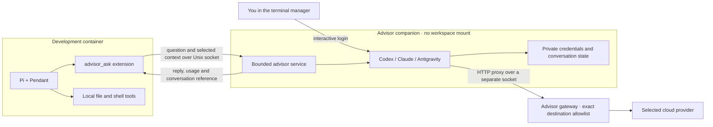

# Advisors

Pi can ask Codex (OpenAI), Claude (Anthropic) or Antigravity (Google) for a second opinion. It sends the question and selected context, receives the reply unchanged, and carries out any suggested work using its own tools and permissions.

## Setup

1. During **New sandbox → Review sandbox**, expand **Advisors** and select Codex (OpenAI), Claude (Anthropic) and/or Antigravity (Google). For an existing sandbox, use **Settings → Advisors**, select the providers, then **Apply**. This builds the companion and restarts the development container; your workspace and private home are preserved.
2. To reuse a host login, select **Copy credentials from host** beneath that advisor before creating or applying. Otherwise, after creation or setup finishes, select **Back to sandboxes**, then reopen **Settings → Advisors**. Sign-in buttons become available only after the advisor has been added; ticking its checkbox alone does not enable login. Codex uses device login: follow the URL in your browser. Antigravity opens its terminal interface in remote-login mode; complete the displayed browser/code flow yourself. Claude uses `claude auth login`; complete its displayed sign-in flow. The manager temporarily gives the terminal to the CLI, so credentials are not collected by the form or operation log.
3. Use **Check advisors** to check Codex/Claude login or display Antigravity's model catalogue and quota. For Antigravity, enter an exact Gemini model ID, its quota group and matching effort, then **Apply** again. You can leave these blank for the initial login; advice requires a configured model.
4. Reopen Pi/Pendant to load the extension. Use `/advisor status`, then ask Pi to consult the advisor. `/advisor usage` shows separate usage; `/advisor cancel` stops an active request. `start` and `resume` retain a conversation reference for follow-up.

Set an optional per-session call limit under **Usage and network**.

The CLI can add providers during creation with `--advisor codex`, `--advisor claude` and/or `--advisor agy`. Sign in afterwards:

```sh
pi-sandbox-factory advisor-login NAME codex
pi-sandbox-factory advisor-login NAME claude
pi-sandbox-factory advisor-login NAME agy
pi-sandbox-factory advisor-check NAME
```

Codex's [device login](https://developers.openai.com/codex/auth/) must be enabled for your account. Antigravity uses its documented [remote login flow and Linux Secret Service](https://antigravity.google/docs/install?tab=cli). The companion has its own keyring; it never mounts your desktop session bus.

## Copy a host sign-in

**Copy credentials from host** is a one-time choice for each advisor. It replaces
that advisor’s saved login with the host login. The CLI equivalent is:

```sh
pi-sandbox-factory advisor-import NAME codex
pi-sandbox-factory advisor-import NAME claude
pi-sandbox-factory advisor-import NAME agy
```

Codex imports the ChatGPT sign-in from `$CODEX_HOME/auth.json` (default
`~/.codex/auth.json`). Claude imports its [subscription login](https://code.claude.com/docs/en/authentication) from
`$CLAUDE_CONFIG_DIR/.credentials.json` (default `~/.claude/.credentials.json`).
Antigravity copies its Linux Secret Service entry; the host needs `secret-tool`
and an unlocked keyring. Install `libsecret` on Fedora or `libsecret-tools` on Ubuntu
if that command is missing. Keyring-only Codex logins require a separate advisor login.

Only credentials are copied, not CLI settings, hooks or conversation history.
The copy lives in the advisor’s private volume; the coding agent receives only
the advisor socket. Copies are not kept in sync. If a provider invalidates a copied
session during renewal, open **Settings → Advisors**, select **Sign in to Codex**,
**Sign in to Claude** or **Sign in to Antigravity**, and complete the login. Then
use **Check advisors** and ask Pi to retry the consultation.

## Choosing an advisor

Each `advisor_ask` call selects one enabled provider. Pi’s tool instructions tell
it to check `advisor_status` for enabled providers, models and available quota,
then choose a provider explicitly when useful. You can ask “Use Claude to review
this change” or “Get separate opinions from Codex and Claude.”

If Pi omits `provider`, the first enabled advisor is used. The TUI orders them
Codex, Claude, Antigravity, so enabling Codex and Claude makes Codex the default.
An existing advisor conversation keeps its original provider and model. Switching
starts a new consultation with the context Pi supplies; there is no automatic
fallback or transfer of the earlier conversation.

## Where things run



The companion has no direct network. Its gateway has a separate allowlist: enabling advisors does not widen the development container's network policy. Provider hosts are supplied as defaults; add exact hosts and ports under **Usage and network** if your account's login route requires others.

Credentials stay in the advisor's private volume. The development container receives only the advisor socket. Provider tools are disabled; Pi carries out suggested work through its own tools and approval rules.

`advisor_ask` has a separate permission rule. Access to the socket permits consultations and consumes provider quota. The service accepts questions and selected context; it rejects arbitrary commands and configuration changes.

Login state survives stopping and rebuilding. Deleting the sandbox removes it. The host account that owns the containers retains access to their storage.

## Claude models and usage

Under **Settings → Advisors → Claude model**, choose `sonnet`, `opus`, `haiku` or an exact model ID and thinking effort. The default is Sonnet at medium effort. Pi can request Opus with an escalation reason or Haiku for simpler questions. `/advisor status` refreshes subscription limits and reset times through Claude's native `/usage`, without inference. Calls stop at the configured quota reserve; unavailable limits are reported as unknown. See the [advisor configuration](https://github.com/kyuz0/pi-advisor/blob/main/docs/configuration.md) for the complete model and quota policy.

The companion installs Claude Code 2.1.318. Copy your host login or sign in after adding Claude; the login survives companion rebuilds and is removed when deleting the sandbox. Existing sandboxes need **Actions → Update sources and recreate…** to load a changed extension pin; reopen the editor afterwards.
