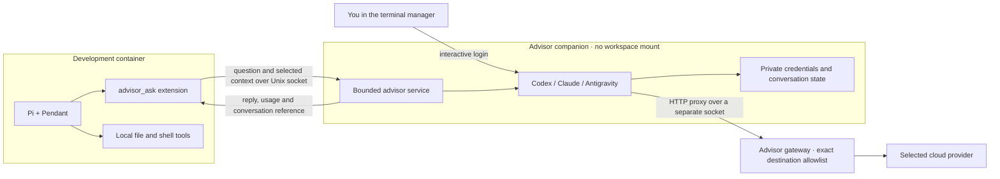

# Advisors

Pi can ask Codex (OpenAI), Claude (Anthropic) or Antigravity (Google) for a second opinion. It sends the question and selected context, receives the reply unchanged, and carries out any suggested work using its own tools and permissions.

## Setup

1. Select advisors under **New sandbox → Advisors** or **Settings → Advisors**.
   **Apply** builds the companion and restarts the development container, preserving
   its workspace and private home.
2. Select **Copy credentials from host** before applying, or return to
   **Settings → Advisors** afterward and choose **Sign in**. Login becomes available
   once the advisor is installed. Follow the CLI's browser or device-code instructions.
3. Use **Check advisors** to check login status and available models or quota.
   Antigravity also needs an exact Gemini model ID, quota group and matching effort;
   enter these after login and **Apply**.
4. Reopen Pi/Pendant, run `/advisor status`, then ask Pi to consult an advisor.
   `/advisor usage` shows usage; `/advisor cancel` stops an active request.
   `start` and `resume` keep a conversation reference for follow-up.

Set an optional per-session call limit under **Usage and network**.

The CLI can add providers during creation with `--advisor codex`, `--advisor claude` and/or `--advisor agy`. Sign in afterwards:

```sh
pi-sandbox-factory advisor-login NAME codex
pi-sandbox-factory advisor-login NAME claude
pi-sandbox-factory advisor-login NAME agy
pi-sandbox-factory advisor-check NAME
```

Codex's [device login](https://developers.openai.com/codex/auth/) must be enabled for your account. Antigravity uses its documented [remote login flow and Linux Secret Service](https://antigravity.google/docs/install?tab=cli). The companion has its own keyring; it never mounts your desktop session bus.

## Copy a host sign-in

**Copy credentials from host** is a one-time choice for each advisor. It replaces
that advisor’s saved login with the host login. The CLI equivalent is:

```sh
pi-sandbox-factory advisor-import NAME codex
pi-sandbox-factory advisor-import NAME claude
pi-sandbox-factory advisor-import NAME agy
```

Codex imports the ChatGPT sign-in from `$CODEX_HOME/auth.json` (default
`~/.codex/auth.json`). Claude imports its [subscription login](https://code.claude.com/docs/en/authentication) from
`$CLAUDE_CONFIG_DIR/.credentials.json` (default `~/.claude/.credentials.json`).
Antigravity copies its Linux Secret Service entry; the host needs `secret-tool`
and an unlocked keyring. Install `libsecret` on Fedora or `libsecret-tools` on Ubuntu
if that command is missing.

On macOS, file-based Codex and Claude logins can be copied through the same paths.
Claude normally stores its login in Keychain; importing that entry is not supported.
Antigravity's macOS Keychain entry and keyring-only Codex logins also require a
separate login through **Settings → Advisors → Sign in**. Use **Check advisors**
after signing in.

Only credentials are copied; CLI settings, hooks and conversations are excluded.
The copy stays in the advisor’s private volume and is not synchronized with the host.
If it expires or is invalidated, use **Settings → Advisors → Sign in** for that
provider, then **Check advisors** and ask Pi to retry.

## Choosing an advisor

Each `advisor_ask` call selects one enabled provider. Pi’s tool instructions tell
it to check `advisor_status` for enabled providers, models and available quota,
then choose a provider explicitly when useful. You can ask “Use Claude to review
this change” or “Get separate opinions from Codex and Claude.”

Without an explicit `provider`, Pi uses the first enabled advisor in this order:
Codex, Claude, Antigravity. Follow-ups keep the original provider and model;
switching starts a new consultation with the context Pi supplies.

## Where things run



The companion has no direct network. Its gateway has a separate allowlist: enabling advisors does not widen the development container's network policy. Provider hosts are supplied as defaults; add exact hosts and ports under **Usage and network** if your account's login route requires others.

Provider tools are disabled; Pi carries out suggested work through its own tools and approval rules.

`advisor_ask` has a separate permission rule. Access to the socket permits consultations and consumes provider quota. The service accepts questions and selected context; it rejects arbitrary commands and configuration changes.

Login state survives stopping and rebuilding. Deleting the sandbox removes it. The host account that owns the containers retains access to their storage.

## Claude models and usage

Under **Settings → Advisors → Claude model**, choose `sonnet`, `opus`, `haiku` or an exact model ID and thinking effort. The default is Sonnet at medium effort. Pi can request Opus with an escalation reason or Haiku for simpler questions. `/advisor status` refreshes subscription limits and reset times through Claude's native `/usage`, without inference. Calls stop at the configured quota reserve; unavailable limits are reported as unknown. See the [advisor configuration](https://github.com/kyuz0/pi-advisor/blob/main/docs/configuration.md) for the complete model and quota policy.

To update the installed advisor, use **Actions → Update sources and recreate…**, then reopen Pi/Pendant.
