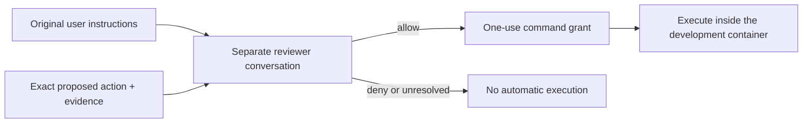

# Automatic approval

Automatic mode uses the current Pi model to review commands that need broader
access. The reviewer has its own conversation, separate from the agent doing
the work. It receives the exact action, original user instructions from the
active Pi branch and relevant tool evidence already available to Pi.

The reviewer makes one model request per approval and has no tools. It judges the
proposed action against the user’s instructions; earlier approvals do not authorize
different actions.

## Conversation and limits

Original user messages are read from Pi's active branch, including originals
before compaction. A generated summary is not treated as user authorization.
New messages and actions are appended to the reviewer conversation. The
controller ignores appended compaction summaries and display metadata. New original
instructions or edits still invalidate an in-flight decision. Parallel reviews use separate copies; branch, model and configuration
changes invalidate reuse.

Context is bounded: up to 8 KiB of whole user messages and 2 KiB of nearby
assistant replies, within an estimated 8,192-token reviewer input budget.
Omissions are reported to the reviewer. When history fills, it is rebuilt from
original instructions; if those cannot be reconstructed intact, automatic
approval is withheld. Reviewer history is held in memory and resets on Pi
restart.

A review can produce up to 32,768 output tokens and has a ten-minute maximum
deadline. Invalid replies, unexpected tool calls,
timeouts and provider failures do not grant permission. Default failure handling
returns the reason to the agent without opening a dialog. The agent can retry a failed
review or choose an allowed alternative. Thinking
is set to low, and its tokens share the output allowance.

## Configuration and updates

The manager's **Settings → Configuration → Agent → Approval mode** setting offers four modes:

- **Automatic — never ask for approval** (default): returns failed or rejected operations to the agent with a reason.
- **Automatic with human fallback**: asks you when automatic review cannot decide.
- **Ask me — human approval**: sends approval requests to you.
- **No approval prompts**: disables command approval; inner sandbox restrictions still apply.

The first two modes use the automatic reviewer. In automatic
mode, `/opt/pi-security/config/auto-review.json` selects the current Pi model and
enables `retainedContext` and `reviewerConversation`. Inspection tools cannot be
enabled. Project files cannot disable this context handling or choose another
reviewer. Configure trusted settings through the image, not through agent-edited
workspace files.

For extension updates, see [Extensions](extensions.md). The outer container,
network and credential boundaries are described in [Architecture](architecture.md).
