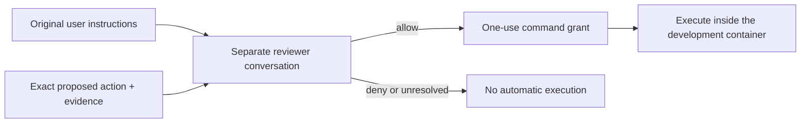

# Automatic approval

Automatic mode uses the current Pi model to review commands that need broader
access. The reviewer has its own conversation, separate from the agent doing
the work. It receives the exact action, original user instructions from the
active Pi branch and relevant tool evidence already available to Pi.

The reviewer has no tools: it cannot inspect files, run shell commands or contact
services. It makes one model request per approval. Earlier approvals are history,
not permission for a different action. For example, “continue editing” does not
cancel “keep changes local”; a later explicit request to push can change that
permission. These are model judgments, not guarantees of correct decisions.

## Conversation and limits

Original user messages are read from Pi's active branch, including originals
before compaction. A generated summary is not treated as user authorization.
New messages and actions are appended to the reviewer conversation. The
controller rejects stale results if the parent conversation changes during
review. Parallel reviews use separate copies; branch, model and configuration
changes invalidate reuse.

Context is bounded: up to 8 KiB of whole user messages and 2 KiB of nearby
assistant replies, within an estimated 8,192-token reviewer input budget.
Omissions are reported to the reviewer. When history fills, it is rebuilt from
original instructions; if those cannot be reconstructed intact, automatic
approval is withheld. Reviewer history is held in memory and resets on Pi
restart. This does not require changing Pi's compaction process.

A review can produce up to 4,096 output tokens and has a ten-minute maximum
deadline. Normal response time depends on the model and context; the deadline
is not a delay imposed on each command. Invalid replies, unexpected tool calls,
timeouts and provider failures do not grant permission. Default failure handling
denies the request; manual approval is available through the existing controls.

## Configuration and updates

The manager's **Settings → Configuration → Agent → Approval mode** setting selects automatic, manual or off. In automatic
mode, `/opt/pi-security/config/auto-review.json` selects the current Pi model and
enables `retainedContext` and `reviewerConversation`. Inspection tools cannot be
enabled. Project files cannot disable this context handling or choose another
reviewer. Configure trusted settings through the image, not through agent-edited
workspace files.

After updating this checkout, use **Actions → Update sources and recreate…** for each existing sandbox
to install the pinned extension, then reopen VS Code/Pi. Rebuilding interrupts
container processes but keeps the workspace and persistent home. Existing running
containers do not receive the extension update automatically.

Approval only permits an exact command inside the development container. It
does not bypass the outer network policy or expose companion credentials. See
[Architecture and permissions](architecture.md) for those boundaries.
