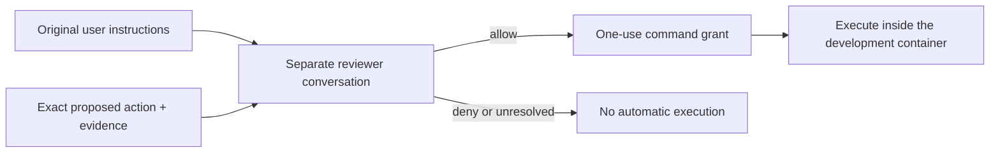

# Automatic approval

Automatic mode uses the current Pi model to review commands that need broader
access. The reviewer has its own conversation, separate from the agent doing
the work. It receives the exact action, original user instructions from the
active Pi branch and relevant tool evidence already available to Pi.

The reviewer makes one model request per approval and has no tools. It judges the
proposed action against the user’s instructions; earlier approvals do not authorize
different actions.

## Choosing a shell

| Task | Tool |
| --- | --- |
| Read installed skill instructions and references | `read`, `grep`, `find`, `ls`, or a read-only Bash command |
| Edit workspace files or run ordinary commands | `bash` inside the inner sandbox |
| Create files for this command only | `bash`, using `$TMPDIR` |
| Keep files for later commands | Use a workspace directory such as `.tmp/` |
| Browser automation with Betterwright enabled | Native `browser` tool |
| Python Playwright or `sandbox-browser` in the spikee profile | `bash_escalate` when the inner sandbox is enabled; otherwise `bash` |
| Create, inspect or stop a tmux session | `bash_escalate`, using the same explicit `tmux -S` socket path each time |
| Reach an outer-container service on loopback | `bash_escalate` when the inner network namespace cannot reach it |

The inner sandbox blocks Unix sockets, so changing tmux's socket directory does
not make it work there. Escalated commands still require review and run inside
the development container. The outer network allowlist and protected credentials
remain enforced. Installed-file read access does not grant write access.

By default, Pi and shell commands cannot read common credential files such as
`.env`, private keys and certificates. For a disposable environment whose
credentials may be shown to the model, clear **Protect common credential files**
under **Settings → Configuration → Permissions and sandbox**. This changes reads
and writes: the agent can see and change those files like other workspace files.

## Conversation and limits

Original user messages are read from Pi's active branch, including originals
before compaction. A generated summary is not treated as user authorization.
New messages and actions are appended to the reviewer conversation. The
controller ignores appended compaction summaries and display metadata. New original
instructions or edits still invalidate an in-flight decision. Parallel reviews use separate copies; branch, model and configuration
changes invalidate reuse.

Context is bounded: up to 8 KiB of whole user messages and 2 KiB of nearby
assistant replies, within an estimated 8,192-token reviewer input budget.
Omissions are reported to the reviewer. When history fills, it is rebuilt from
original instructions; if those cannot be reconstructed intact, automatic
approval is withheld. Reviewer history is held in memory and resets on Pi
restart.

A review can produce up to 32,768 output tokens and has a ten-minute maximum
deadline. Invalid replies, unexpected tool calls,
timeouts and provider failures do not grant permission. Default failure handling
returns the reason to the agent without opening a dialog. The agent can retry a failed
review or choose an allowed alternative. Thinking
is set to low, and its tokens share the output allowance.

## Configuration and updates

For an existing sandbox, select it in the Factory manager, open
**Settings → Configuration**, and expand **Permissions and sandbox**. Choose **Approval mode**, change
**Use inner command sandbox** or **Protect common credential files**, then select **Apply and recreate**.
This stops running processes, including tmux sessions, but preserves files and
saved chats. Reopen Pi or Pendant to resume the conversation with the new settings.

Pi has no slash command for these Factory settings. `/reload` does not change them.
The extension's `/auto-review-approve` command in Pi's interactive TUI requests
one retry of an exact denied action; it does not change the approval mode.

The approval modes are:

- **Automatic — never ask for approval** (default): returns failed or rejected operations to the agent with a reason.
- **Automatic with human fallback**: asks you when automatic review cannot decide.
- **Ask me — human approval**: sends approval requests to you.
- **No approval prompts**: disables command approval; inner sandbox restrictions still apply.

The first two modes use the automatic reviewer. In automatic
mode, `/opt/pi-security/config/auto-review.json` selects the current Pi model and
enables `retainedContext` and `reviewerConversation`. Inspection tools cannot be
enabled. Project files cannot disable this context handling or choose another
reviewer. Configure trusted settings through the image, not through agent-edited
workspace files.

For extension updates, see [Extensions](extensions.md). The outer container,
network and credential boundaries are described in [Architecture](architecture.md).
