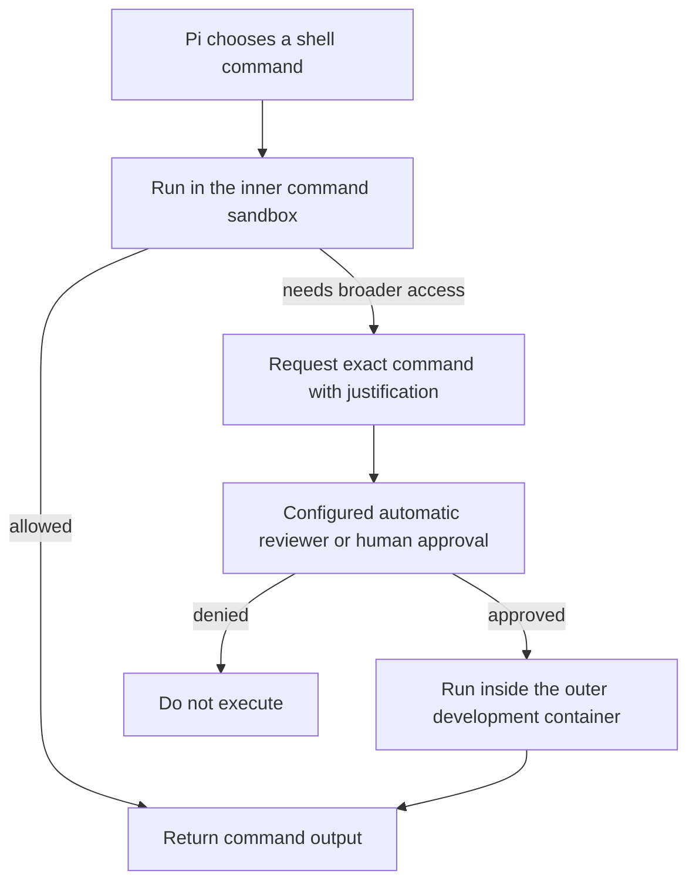

# Architecture and permissions

## Files and processes

The terminal manager runs on the host and manages rootless Podman containers. VS Code runs on the host; its Dev Containers attachment runs Pendant and Pi against the development container. The selected host folder is mounted at `/workspace`, so edits are real changes to that folder.

Each sandbox has a separate persistent home volume for Pi configuration and sessions. Editor state is kept separately on the host. Stopping or recreating containers preserves that saved state. Deleting a sandbox removes its private home and editor state, but keeps the selected workspace and shared images.

## Restricted networking

The development container uses `--network=none`. HTTP clients use its inherited proxy environment and a local relay to a Unix socket in a shared volume. A separate gateway container runs the socket relay and Squid, which checks exact destination hostname/port pairs. The development container mounts the socket volume read-only.

For host-local models, the rootless Podman gateway uses pasta's host-loopback mapping. `local-model.internal:8000` reaches the host model server at port 8000; it is not a server running in the development container. The discovery extension reads server metadata and writes the private Pi catalogue. It does not start servers or download model files.

Updating allowed destinations restarts only the gateway. Existing network requests may fail and need retrying. Changing networking mode or model-port configuration through Configuration recreates containers and interrupts their processes. Unrestricted mode instead gives the development container ordinary bridge networking.

## Commands, approval and skills

The default is an inner command sandbox with automatic approval review using the current Pi model. The reviewer keeps a separate, bounded conversation with original user instructions and the exact proposed action; it has no inspection tools. See [Automatic approval](approvals.md) for context handling, limits and updates. Manual mode asks the user instead. With the inner sandbox enabled and approval prompts disabled, commands requiring elevation are refused. Disabling the inner sandbox changes how ordinary shell commands are authorized; it does not remove container isolation or the outer network policy.

Elevation means leaving the inner command restrictions for one approved command. It is not host execution, container privilege escalation or an unrestricted network connection. These inner restrictions apply to shell execution; do not mistake them for a separate OS sandbox around every extension or every Pi process.

Skills supply task instructions. Extensions add capabilities such as model discovery, Goal and scheduled prompts. Additional skills are configured explicitly; browser support and subagents are optional. Installing a skill does not automatically allow the websites it might use. Scheduled prompts run only while their originating Pi session is open.
