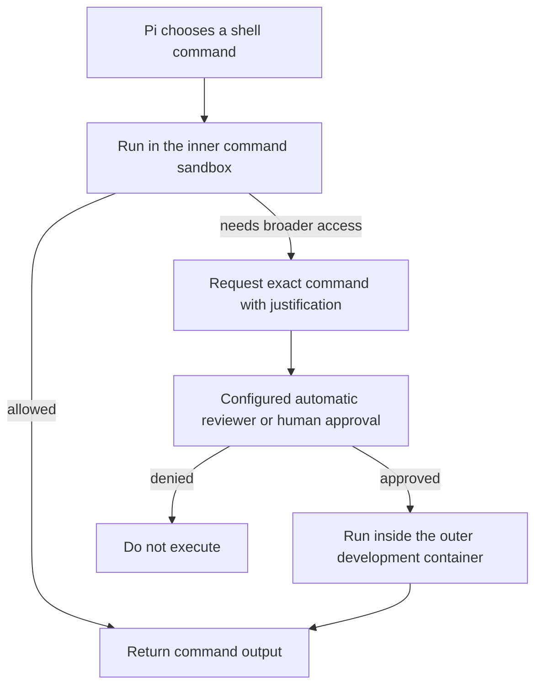

# Architecture and permissions

## Files and processes

The terminal manager runs on the host and manages rootless Podman containers. VS Code runs on the host; its Dev Containers attachment runs Pendant and Pi against the development container. The selected host folder is mounted at `/workspace`, so edits are real changes to that folder.

Each sandbox has a separate persistent home volume for Pi configuration and sessions. Editor state is kept separately on the host. Stopping or recreating containers preserves that saved state. Deleting a sandbox removes its private home and editor state, but keeps the selected workspace and shared images.

## Restricted networking

The development container uses `--network=none`. HTTP clients use its inherited proxy environment and a local relay to a Unix socket in a shared volume. A separate gateway container runs the socket relay and Squid, which checks exact destination hostname/port pairs. The development container mounts the socket volume read-only.

For host-local models, the rootless Podman gateway uses pasta's host-loopback mapping. `local-model.internal:8000` reaches the host model server at port 8000. The discovery extension reads that server’s metadata and updates Pi’s model catalogue.

Updating allowed destinations restarts only the gateway. Existing network requests may fail and need retrying. Changing networking mode or model-port configuration through Configuration recreates containers and interrupts their processes. Unrestricted mode instead gives the development container ordinary bridge networking.

## Commands, approval and skills

The default is an inner command sandbox with automatic approval review using the current Pi model. The reviewer keeps a separate, bounded conversation with original user instructions and the exact proposed action; it has no inspection tools. See [Automatic approval](approvals.md) for context handling, limits and updates. Manual mode asks the user instead. With the inner sandbox enabled and approval prompts disabled, commands requiring elevation are refused. Disabling the inner sandbox changes how ordinary shell commands are authorized; it does not remove container isolation or the outer network policy.

An approved escalation runs one command in the development container under its existing user, mounts and network rules. The inner restrictions apply to shell commands; Pi and its extensions run in the development container.

Skills supply task instructions. Extensions add capabilities such as model discovery, questions and scheduled prompts. Pendant provides built-in goals. Additional skills are configured explicitly; browser support and subagents are optional. Installing a skill does not automatically allow the websites it might use. Scheduled prompts run only while their originating Pi session is open.

## Packages

The host registry stores exported Git revisions. Each sandbox copies its selected
profile and providers into its own immutable build inputs. Installing or updating
a registry entry does not change a running sandbox. Rebuilding applies updates
only after the new image builds successfully.

A profile adds tools and Pi resources. A provider adds a small adapter run inside
the development container, plus optional Pi extensions and skills. Both Pi and
Pendant use the private home catalogue. A shared lock serializes model updates;
credentials enter through stdin and are never included in image layers.

Browser support uses one headless Chromium per Pi session inside the development
container. A host Python process relays authenticated viewer requests through a
fixed container helper; it has no arbitrary destination or command interface.
The helper checks the session endpoint format and browser identifier before connecting. The viewer
serves a tab list and Chromium’s existing DevTools frontend, with page WebSockets
for interaction. It rebuilds response headers and restricts frontend network requests to the viewer.
Each viewer uses its own loopback address. Host cookies and authorization headers
are never forwarded.
Opening the sandbox repairs a stopped viewer; stopping the container ends it.
The viewer key rotates on restart. Session links are capabilities, visible in
chat history. Sessions share the container Unix user, so their identifiers prevent
accidental mix-ups rather than providing isolation against malicious container code.
The DevTools frontend comes from the installed browser image. As with profiles and
extensions, the viewer assumes that installed container software is trusted.
