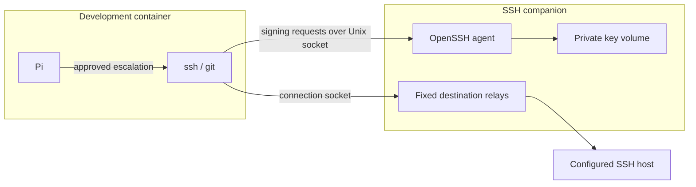

# SSH and GitHub

## GitHub over HTTPS

Enable **GitHub** under **Settings → Network → Website categories** for repository
browsing, API requests, clones and release downloads over HTTPS.

For authenticated Git operations with an isolated private key, use SSH.

## SSH setup

1. Open **Settings → SSH**. Import aliases from your host's SSH configuration, or enter one destination per line: `alias username hostname port`.
2. Supply trusted host keys through your existing `known_hosts` file, then **Apply**. Applying destinations restarts the sandbox processes and preserves the workspace and private home.
3. Return to **SSH → Host identity and private key**, select a key outside the workspace, and choose **Import key and unlock**. Enter its passphrase directly in your terminal.
4. Use the alias from the sandbox, for example `ssh build 'hostname && uptime'`. With the inner command sandbox enabled, Pi uses `bash_escalate`, subject to manual or automatic approval.

Keys are loaded for eight hours. Use **Unlock existing key** after expiry or after restarting a companion with an encrypted key. Unencrypted keys load automatically when the companion starts.

CLI key management after configuring destinations:

```sh
pi-sandbox-factory ssh-import-key NAME --key-file ~/.ssh/id_ed25519
pi-sandbox-factory ssh-unlock NAME
```

For GitHub, configure an alias such as `github-project`, username `git`, hostname `github.com`, port `22`, and its trusted host keys. Import a key with the repository access you need. A read-only deploy key limits access to one repository.

```sh
git ls-remote git@github-project:OWNER/REPOSITORY.git HEAD
```

## Where the key stays



The development container receives sockets and public host configuration. The private key file stays in the companion. OpenSSH constrains its use to the configured users and trusted host identities. Each sandbox holds one imported key; use separate sandboxes for separate keys.

SSH grants the remote account's permissions. Configure those permissions for the work you intend to allow. Removing all destinations disables access; deleting the sandbox removes its private key copy and companion volumes. Your original key and workspace remain on the host.
