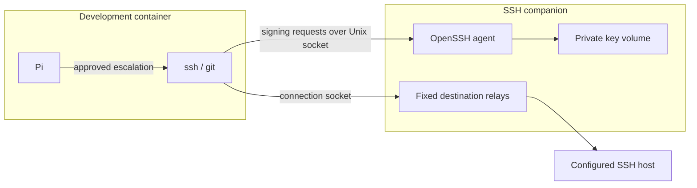

# SSH and Git repositories

## GitHub over HTTPS

Enable **GitHub** under **Settings → Network → Website categories** for repository
browsing, API requests, clones and release downloads over HTTPS.

For authenticated Git operations with an isolated private key, use SSH.

## SSH setup

For GitHub or GitLab, use **Add repository…** and follow [repository setup](repository-access.md).

1. Open **Settings → SSH and repositories**. Import aliases from your host's SSH configuration, or enter one destination per line: `alias username hostname port`.
2. Supply trusted host keys through your existing `known_hosts` file, then **Apply**. Applying destinations restarts the sandbox processes and preserves the workspace and private home.
3. Return to **SSH and repositories → SSH key**, select a key outside the workspace, and choose **Import and unlock**. Enter its passphrase directly in your terminal.
4. Use the alias from the sandbox, for example `ssh build 'hostname && uptime'`. With the inner command sandbox enabled, Pi uses `bash_escalate`, subject to manual or automatic approval.

Adding a destination configures its connection route; it does not import a key.
Run `sandbox-ssh-status` in the container (through `bash_escalate` in Pi) to check
the configured destinations and whether the signing agent has an unlocked key.
`no_unlocked_key` requires **Import and unlock** or **Unlock existing key** in
Factory. Keys stay in the companion, so an absent `~/.ssh` directory is expected.
With the inner sandbox enabled and approval off, agent SSH commands are unavailable;
choose an approval mode first. Without the inner sandbox, use ordinary Bash.
Use the managed SSH configuration without overriding `GIT_SSH_COMMAND` or host-key
checking. Inner-shell DNS and TCP probes cannot test the companion's socket route.

Generate creates an unencrypted key inside the private companion volume and refuses to replace an existing key. Import replaces the companion’s saved key.

Keys are loaded for eight hours. Use **Unlock existing key** after expiry or after restarting a companion with an encrypted key. Unencrypted keys load automatically when the companion starts.

CLI key management after configuring destinations:

```sh
pi-sandbox-factory ssh-import-key NAME --key-file ~/.ssh/id_ed25519
pi-sandbox-factory ssh-unlock NAME
pi-sandbox-factory ssh-generate-key NAME
pi-sandbox-factory ssh-public-key NAME
```

For GitHub, configure an alias such as `github-project`, username `git`, hostname `github.com`, port `22`, and its trusted host keys. Import a key with the repository access you need. A read-only deploy key limits access to one repository.

```sh
git ls-remote git@github-project:OWNER/REPOSITORY.git HEAD
```

## Where the key stays



The development container receives sockets and public host configuration. The private key file stays in the companion. OpenSSH constrains its use to the configured users and trusted host identities. Each sandbox holds one imported key; use separate sandboxes for separate keys.

A process in the sandbox can use the signing socket while the key is unlocked,
including a malicious extension. Destination constraints restrict the SSH server
and username; they do not restrict repositories, branches or Git commands. The Git
server enforces those permissions. Use a repository deploy key or a dedicated
automation identity rather than your personal key. See
[repository permissions](repository-access.md).

Removing all destinations disables access; deleting the sandbox removes its private
key copy and companion volumes. Your original key and workspace remain on the host.
